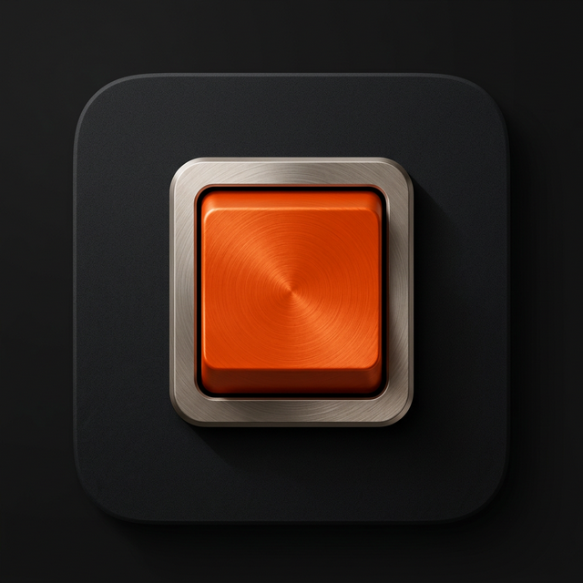
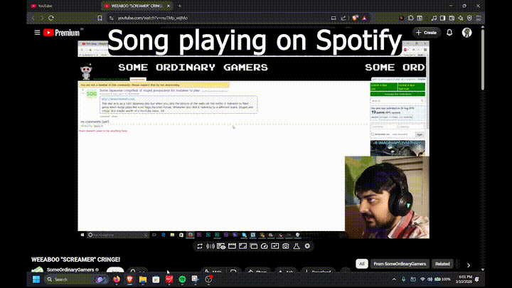

<p align="center">
  
</p>

<h1 align="center">StillSound Studio</h1>

<p align="center">
  <a href="https://github.com/saketjndl/StillSound-Studio/releases">
    
  </a>
  <a href="https://github.com/saketjndl/StillSound-Studio/releases">
    
  </a>
  <a href="https://github.com/saketjndl/StillSound-Studio/stargazers">
    
  </a>
  <a href="https://github.com/saketjndl/StillSound-Studio/issues">
    
  </a>
  <a href="LICENSE">
    
  </a>
  
  
  
</p>

<p align="center">
  <strong>The Universal Media Sync Engine & Ambient Studio Console. Automatically pauses your music when any video or media plays.</strong>
</p>

<p align="center">
  <a href="https://github.com/saketjndl/StillSound-Studio/releases">Download</a> ·
  <a href="#key-features">Key Features</a> ·
  <a href="#demo">Demo</a> ·
  <a href="#how-it-works">How It Works</a> ·
  <a href="#installation">Installation</a>
</p>

---

**StillSound Studio** is a lightweight, cross-platform desktop console and browser sync engine designed for seamless workflow immersion. It automatically pauses your Spotify or system media player whenever you play a video (on YouTube, Netflix, Twitter/X, Reddit, Twitch, Udemy, Zoom, and more), and instantly resumes your music the moment you stop. 

No more manual alt-tabbing, fumbling for media keys during lectures, or losing your focus while browsing feeds.

## ✨ Key Features

- **🧠 4-Tier Smart Session Priority Engine**: Never gets confused by background system media players or idle sessions. StillSound intelligently scans OS media channels (Windows SMTC, macOS MediaRemote, Linux MPRIS) to bind instantly to actively playing audio or loaded music tracks.
- **⚡ Deterministic State Synchronization**: Zero-guesswork media toggling. Your desktop UI, keyboard shortcuts, and browser extension remain strictly synchronized with OS-level playback states, eliminating play/pause inversion.
- **🌐 Universal Multi-Site & App Support**: Seamlessly monitors streaming platforms (**YouTube, Netflix, Prime Video, Disney+, Twitch**), social feeds (**Twitter/X, Reddit, Instagram, Facebook**), educational sites (**Udemy, Coursera, Khan Academy**), and conference calls (**Zoom, Google Meet, MS Teams**). Toggle individual sites on or off directly in your dashboard.
- **🎨 Audio-Responsive Glassmorphic UI**: An iOS-inspired Dynamic Island dashboard that extracts real-time color palettes from your live album artwork, bathing your workspace in dynamic ambient glow.
- **🔌 Universal Mode (Zero-Setup OS Media Control)**: Control any music player (**Spotify, Apple Music, VLC, Tidal, iTunes, Deezer**) offline without OAuth, API tokens, or an active internet connection.
- **📱 Bi-Directional Volume & Multi-Device Handoff**: Adjust volume seamlessly across desktop and mobile devices with real-time Spotify API sync, while seeing exactly which device is playing.
- **📊 Built-in Focus & Music Recap**: Track your productive study minutes, listening time, and total automatic pauses saved directly in your weekly studio recap.

---

## 🎥 Demo

<div align="center">
  
</div>

---

## 🚀 Versions & Changelog

### v3.0.0 (The Audio Intelligence & Studio Companion Upgrade)
- **Smooth Audio Ducking & Fade Engine**: Eliminates abrupt hard-cutting when scrolling social feeds (Twitter/X, Reddit, Instagram). Smoothly ramps music volume down to 20% over a 300ms curve while short-form clips play, and swells back up seamlessly when finished.
- **Per-Site Action Matrix**: Advanced 3-way control (`[Pause | Duck | Ignore]`) per website or domain. Allows granular control (e.g., Full Pause on YouTube/Netflix lectures vs. Smooth Duck on social feeds).
- **Smart Rewind on Resume**: Intelligent context restoration for podcasts, audiobooks, and songs. After pausing for >30 seconds, StillSound automatically seeks back 5 seconds on resume so you never lose the train of thought.
- **Mic / Call-Aware Meeting Mode**: Detects when your microphone activates during Zoom, Google Meet, MS Teams, or Discord calls and automatically ducks or pauses your music with Push-to-Talk debouncing.
- **Floating Mini-HUD Desktop Overlay**: An always-on-top, draggable, glassmorphic pill widget (`minihud.html`) providing live track info, album art, play/pause controls, and ducking status right on your desktop.

### v2.5.0 (The Smart Sync & Universal Studio Upgrade)
- **4-Tier Smart Session Hierarchy**: Re-architected OS media session selection across Windows SMTC, macOS, and Linux. Prioritizes actively playing media and loaded music players over idle system sessions, guaranteeing instant track detection on app launch.
- **Deterministic Play/Pause Sync**: Upgraded backend media control IPC to accept explicit target states from UI and extension triggers, permanently eliminating play/pause inversion when toggling controls.
- **Resilient Extension Bridge**: Implemented automatic background script re-injection and self-healing WebSocket reconnects, ensuring your browser extension never loses connection after reloads or browser restarts.
- **UI & Iconography Polish**: Refined SVG iconography (14x14 crisp gear and control buttons with rounded joins), standardized CSS range sliders, and optimized glassmorphic layout rendering across all desktop views.

### v2.0.0 (The Universal Update)
- **Universal Multi-Site Support**: Expanded beyond YouTube to support over 15+ major streaming, social, educational, and conferencing platforms with modular site toggles.
- **Universal Mode (Beta)**: Zero-setup media key fallback! Control any desktop music player without OAuth or internet connection.
- **Cross-Platform Installers**: Native installers for Windows (`.exe`/`.msi`), Linux (`.deb`/`.AppImage`), and macOS (`.dmg`).
- **Dynamic Island UI**: A complete aesthetic overhaul featuring an iOS-inspired Dynamic Island with album art, track details, and ambient glow.
- **Multi-Device Hand-off & Volume Sync**: Real-time device awareness and bi-directional volume slider synchronization.

### v1.2.0 & Earlier
- **v1.2.0 (Multi-Browser Sync)**: Intelligent cross-browser aggregation ensures music only resumes when ALL connected browsers stop playing.
- **v1.1.0 (System Tray & Autostart)**: Minimize to system tray and optional boot autostart.
- **v1.0.0 (Initial Release)**: Core WebSocket sync engine and Spotify OAuth PKCE flow.

---

## ⚙️ How It Works

```
┌─────────────────────┐     WebSocket      ┌──────────────────┐     OS SMTC / API     ┌──────────────────┐
│ Multiple Browsers   │ ◄───────────────► │  StillSound App  │ ◄─────────────────► │ Spotify / iTunes │
│ (Chrome, FF, Brave) │   localhost:9876    │  (Desktop Studio)│     Native / REST     │ VLC / Apple Music│
└─────────────────────┘                    └──────────────────┘                     └──────────────────┘
```

1. The **Browser Extension** monitors media elements across your active tabs on enabled websites.
2. When video playback starts or stops, it broadcasts state changes over an ultra-low-latency local WebSocket (`localhost:9876`) to the **StillSound Desktop Studio**.
3. The desktop engine evaluates the aggregated browser state and commands your native OS media session (or Spotify API) to pause or resume your music instantly.

---

## 📦 Installation

### Desktop App (Windows, Linux, macOS)

1. Download the installer for your operating system from the [Releases](https://github.com/saketjndl/StillSound-Studio/releases) page:
   - **Windows**: `.exe` or `.msi`
   - **Linux**: `.deb` or `.AppImage`
   - **macOS**: `.dmg` (Apple Silicon & Intel)
2. Run the installer and launch **StillSound Studio**!

> [!NOTE]
> **macOS Users (Gatekeeper Notice):**
> Since StillSound is free and open-source, the macOS installer is not signed with a paid Apple Developer certificate. When opening the `.dmg` or `.app` for the first time, macOS Gatekeeper may display a message saying *“StillSound can’t be opened because Apple cannot check it for malicious software”*.
>
> **To allow StillSound to open:**
> 1. Open Terminal and run: `xattr -cr /Applications/StillSound.app`
> 2. Alternatively: Go to **System Settings → Privacy & Security**, scroll down to the Security section, and click **Open Anyway**.
> 3. For **Universal Mode** on macOS, make sure to grant **Automation** and **Accessibility** permissions when prompted so StillSound can control your music players.

### Browser Extension (Chrome / Brave / Edge / Firefox)

#### Chrome, Brave & Edge
1. Download or clone this repository to get the `browser-extension` folder.
2. Open your browser and navigate to `chrome://extensions/` (or `edge://extensions/`).
3. Enable **Developer Mode** (toggle in the top right).
4. Click **Load Unpacked** → select the `browser-extension` folder.

#### Firefox
1. Open Firefox and navigate to `about:debugging` → click **This Firefox**.
2. Click **Load Temporary Add-on**.
3. Select the `manifest.json` file inside the `browser-extension` folder.

---

## 🎯 First-Time Setup

1. **Launch StillSound Studio**: By default, it runs in **Universal Mode**, ready to control your native OS music players immediately without any setup!
2. **Optional (Spotify API Mode)**: If you prefer full Spotify API features (like multi-device handoff and remote volume sync), click **Connect to Spotify** on the setup screen, sign in, and approve access.

> **Advanced Spotify Setup:** If you hit custom API rate limits, you can bring your own Client ID. Click **Advanced setup** on the connect screen, create an app on the [Spotify Developer Dashboard](https://developer.spotify.com/dashboard), set the Redirect URI to `http://127.0.0.1:8921/callback`, and paste in your Client ID.

---

## 🛠️ Building from Source

Requires **Rust** (latest stable), **Node.js** (v18+), and OS build tools (MSVC on Windows, Xcode on macOS, build-essential on Linux).

```bash
# Install dependencies
npm install

# Run in development mode with live reload
npm run dev

# Build production installer (.exe / .dmg / .deb)
npm run build
```

The compiled installer bundles will be generated in `src-tauri/target/release/bundle/`.

---

## 📁 Project Structure

```
├── src/                    # Desktop Studio Frontend (HTML5 / Vanilla CSS / JS)
│   ├── index.html          # Modular View Architecture (Dash, Settings, Setup)
│   ├── styles.css          # Design System & Glassmorphic Tokens
│   └── main.js             # UI Controller & WebSocket Bridge Client
├── src-tauri/              # Rust Native Backend & OS Media Engines
│   ├── src/lib.rs          # State Manager, WebSocket Server & Command Handlers
│   ├── src/smtc_backend.rs # Windows SMTC (System Media Transport Controls) Engine
│   ├── src/macos_backend.rs# macOS MediaRemote & AppleScript Engine
│   ├── src/mpris_backend.rs# Linux MPRIS D-Bus Media Engine
│   ├── tauri.conf.json     # App Configuration & Build Manifest
│   └── Cargo.toml          # Rust Dependencies
└── browser-extension/      # Manifest V3 Browser Extension
    ├── manifest.json       # Extension Manifest & Permissions
    ├── background.js       # Service Worker & Self-Healing WebSocket Client
    ├── content.js          # Media Element Observer & Site Aggregator
    ├── popup.html          # Extension Popup Interface
    └── popup.js            # Extension Playback Controller
```

---

## 👏 Credits & Support

Built with ❤️ by **saketjndl (.sodiumcyanide)**.

If StillSound Studio improves your daily focus or study workflow, please consider [starring the repository](https://github.com/saketjndl/StillSound-Studio) ⭐!

---

## 📄 License

Distributed under the [MIT License](LICENSE).
